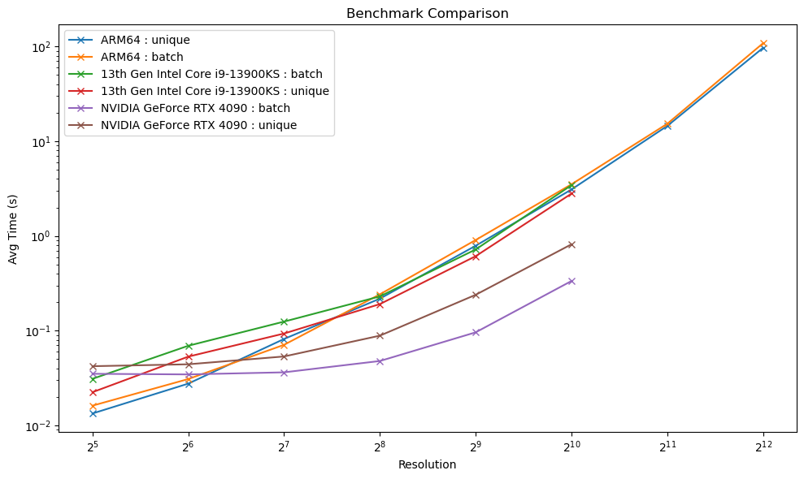
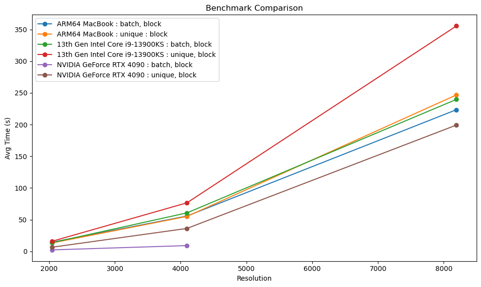

# Benchmarking

## Code
The `batch` function is:
```python
def g_nu_batch(
        evals: Tensor, 
        evecs: Tensor, 
        evecs_inv: Tensor, 
        zero_ind: Tensor, 
        small_mask: Tensor, 
        omega: Tensor
) -> Tensor:
    
    B = omega.numel() 

    denom = -evals.unsqueeze(0) - 1j * omega.unsqueeze(1)
    denom = denom.to(evals.dtype)

    inv = torch.zeros_like(denom)
    if (~small_mask).any():
        inv[:, ~small_mask] = 1.0 / denom[:, ~small_mask]

    inv[:, zero_ind] = 0.0

    evecsb = evecs.unsqueeze(0).expand(B, -1, -1)
    evecs_invb = evecs_inv.unsqueeze(0).expand(B, -1, -1)

    tmp = evecsb * inv.unsqueeze(1)

    return torch.bmm(tmp, evecs_invb)


```

The `unique` function is:
```python
def g_nu_batch_unique(
        evals: Tensor,
        evecs: Tensor,
        evecs_inv: Tensor, 
        zero_ind: Tensor, 
        small_mask: Tensor, 
        omega: Tensor
) -> Tensor:

    nu_flat = omega.reshape(-1)
    nu_cpu  = nu_flat.detach().to(torch.float64).cpu().contiguous()
    uniq_vals, inverse = torch.unique(nu_cpu, return_inverse=True)

    if uniq_vals.numel() == 0:
        m = evals.numel()
        return torch.zeros((0, m, m), dtype=evecs.dtype, device=evecs.device)

    uniq = uniq_vals.to(device=omega.device, dtype=omega.dtype)
    G_uniq = g_nu_batch(evals, evecs, evecs_inv, zero_ind, small_mask, uniq)

    inverse_dev = inverse.to(G_uniq.device)
    out = G_uniq.index_select(0, inverse_dev)
    return out.view(nu_flat.shape[0], *G_uniq.shape[1:])

```


## Model
To benchmark, I used a very simple quantum system. This model has no Hamiltonian, $H = 0$, with two collapse operators:
```math
d_1 = \begin{pmatrix}
        0 & 1 \\
        0 & 0
    \end{pmatrix}\,, 
d_2 = \begin{pmatrix}
        0 & 0 \\
        1 & 0
    \end{pmatrix}
```
These collapse operators have strengths of $\gamma_1 = 0.3$ and $\gamma_2 = 0.5$ units. I only use one measurement (because later I will do a benchmark with the fist version of QuantumCatch written in ArrayFire and for a fair comparison I need identical systems and that version can only take one measurement operator.) 
```math
c_1 = \begin{pmatrix}
        0 & 0 \\
        0 & 1
    \end{pmatrix}
```
with a strength of $\beta_1 = 5$ unit.


The fact that the system is small makes the comparison between CPU and GPU calculation time misleading, however. Because CUDA shines for massive overloads and not small tensors like this example. I have to emphesize that **THIS IS NOT A COMPARISON BETWEEN GPU AND CPU BACKENDS BUT ONLY A COMPARISON BETWEEN TWO ALGORITHMS**:

## Results
In this document, I benchmark the two ways I calculate the propagator. Once is the conventional batches and vectorizing the matrix multiplications. The other way is "**unique_batches**" where we avoid the duplicates. From now on, I will call them `batch` and `unique` method. It is important to keep in mind that inside the `unique` method there is still the `batch` method.

ARM64 MacBook : unique
|Resolution |   Time (s)|
|-----------|------------|
 |      128 |   0.060148|
 |      256 |   0.205889|
 |      512 |   0.783300|
 |     1024 |   3.167536|
 |     2048 |  17.085888|
 |     4096 | 104.258061|

ARM64 MacBook : batch
| Resolution |   Time (s)|
|-------------|-----------|
|       128 |   0.071030|
|       256 |   0.245407|
|       512 |   0.917591|
|      1024 |   3.574566|
|      2048 |  15.289475|
|      4096 | 115.277794|

clearly something is happening between 2K and 4K. So I decided to run the tests tree times and then calculate the average

ARM64 MacBook : unique
Resolution |   Avg Time (s)|
|-------------|-----------|
 |       32 |       0.013353|
 |       64 |       0.027604|
 |      128 |       0.081757|
 |      256 |       0.217970|
 |      512 |       0.788753|
 |     1024 |       3.099331|
 |     2048 |      14.533886|
 |     4096 |      97.086141|


ARM64 MacBook : batch
|Resolution |   Avg Time (s)|
|-------------|-----------|
 |       32 |       0.016152|
 |       64 |       0.030861|
 |      128 |       0.070924|
 |      256 |       0.242084|
 |      512 |       0.906989|
 |     1024 |       3.514839|
 |     2048 |      15.322787|
 |     4096 |     108.657303|


Our PC didn't have the capacity to calculate s3 and s4 with high resolution at once (more below) so the first benchmark could be done up tp $2^10$. 
13th Gen Intel Core i9-13900KS : batch
|Resolution |   Avg Time (s)|
|-------------|-----------|
|        32 |       0.031009|
|        64 |       0.069300|
|       128 |       0.124708|
|       256 |       0.230146|
|       512 |       0.720663|
|      1024 |       3.440802|

13th Gen Intel Core i9-13900KS : unique
|Resolution |   Avg Time (s)|
|-------------|-----------|
|        32 |       0.022405|
|        64 |       0.053213|
|       128 |       0.093348|
|       256 |       0.190909|
|       512 |       0.612202|
 |     1024 |       2.802864|


NVIDIA GeForce RTX 4090 : batch
|Resolution |   Avg Time (s)|
|-------------|-----------|
|        32 |       0.035057|
 |       64 |       0.034536|
|       128 |       0.036333|
|       256 |       0.047844|
|       512 |       0.096085|
|      1024 |       0.334867|


NVIDIA GeForce RTX 4090 : unique
|Resolution |   Avg Time (s)|
|-------------|-----------|
|        32 |       0.042166|
|        64 |       0.044177|
|       128 |       0.053425|
|       256 |       0.088606|
|       512 |       0.239342|
|      1024 |       0.817418|

Here is the results:



I have wrote the saftey measure `block` which can be used if the whole matrix multiplication cannot be done in one go. Here I choose `block = 2^16`. The reason for power 16 was that it was the highest power of two that worked for all the three resolutions I wanted to test on without memory leak. (The bigger the block the faster the calculation.)

ARM64 MacBook : batch
|Resolution |   Avg Time (s)|
|-----------|------------|
|      2048 |      14.374719|
|      4096 |      55.665838|
|      8192 |     223.368022|

ARM64 MacBook : unique
|Resolution |   Avg Time (s)|
|-----------|------------|
|      2048 |      13.308989|
|      4096 |      55.075591|
|      8192 |     246.751968|

13th Gen Intel Core i9-13900KS : batch
|Resolution |   Avg Time (s)|
|-------------|-----------|
|      2048 |      13.771163|
|      4096 |      60.684534|
|      8192 |     239.679571|

13th Gen Intel Core i9-13900KS : unique
|Resolution |   Avg Time (s)|
|-------------|-----------|
 |     2048 |      15.942254|
 |     4096 |      76.528558|
 |     8192 |     355.533826|

NVIDIA GeForce RTX 4090 : batch
|Resolution |   Avg Time (s)|
|-------------|-----------|
|      2048 |       2.286470|
|      4096 |       9.065482|
|       8192|       memory leak|

NVIDIA GeForce RTX 4090 : unique
|Resolution |   Avg Time (s)|
|-------------|-----------|
|      2048 |       6.541375|
|      4096 |      36.142656|
|      8192 |     199.186671|



# Conclusion

I have decided to retire the `unique` method due to the following:

## No Block Mode
It is no surprise that the parallel computing beats the calculations on CPU AS LONG AS the overhead isn't high. We see this problem when the resolution is low $<2^7$. The higher the resolution the more CUDA can shine. But the real comparison between the two algorithm `unique` and `batch` shows that `batch` is significantly faster than unique when the program runs on CUDA backend. This is not the same when the program runs on CPU backend. For both M2 and Intel Core i9 chip the `unique` method is slightly faster than `batch`. However, the speedup is not significant at all.

## Block Mode
In the block mode, that the `batch` version is always faster than `unique` version. My PC couldn't handle when calculating spectra of resolution $2^{13}\times 2^{13}$ but it has nothing to do with the calculation time but rather a question for VRAM and RAM. 


